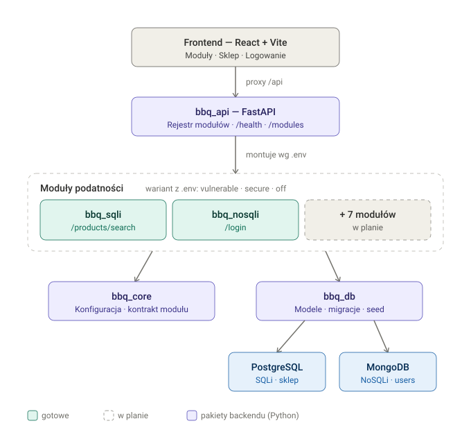

# Jak uruchomić BBQShop

Przewodnik krok po kroku: co zainstalować i co po kolei wpisać, żeby odpalić aplikację.

> ⚠️ Projekt jest **celowo podatny** i służy wyłącznie do nauki (TBO). Uruchamiaj go tylko lokalnie, nigdy nie wystawiaj do internetu.

## Architektura w skrócie



Przeglądarka (React) → FastAPI (`bbq_api`) → moduły podatności (np. `bbq_sqli`, `bbq_nosqli`) → wspólne `bbq_core` i `bbq_db` → PostgreSQL i MongoDB. Każdy moduł ma wersję **podatną** i **poprawioną**, wybieraną w pliku `.env`.

---

## 1. Co zainstalować (wymagania)

| Narzędzie | Do czego | Link |
|-----------|----------|------|
| **Docker** (z Docker Compose) | uruchomienie baz i całej aplikacji w kontenerach | https://www.docker.com/products/docker-desktop/ |
| **uv** | menedżer Pythona i zależności (backend) | https://docs.astral.sh/uv/ |
| **Node 24** | frontend (tylko w trybie deweloperskim) | https://nodejs.org/ |
| **Git** | pobranie repozytorium | https://git-scm.com/ |

Sprawdzenie, czy wszystko jest zainstalowane:

```bash
docker --version
docker compose version
uv --version
node --version
```

Pobranie repozytorium (jeśli jeszcze go nie masz):

```bash
git clone https://github.com/MichalKaminski23/BBQShop.git
cd BBQShop
```

---

## 2. Konfiguracja – plik `.env`

Skopiuj przykładowy plik konfiguracyjny:

```bash
cp .env.example .env
```

W pliku `.env` ustawiasz, w jakiej wersji działa każdy moduł. Wartości: `vulnerable` (podatny), `secure` (poprawiony), `off` (wyłączony).

```
BBQ_MODULE_SQLI=vulnerable
BBQ_MODULE_NOSQLI=vulnerable
```

---

## 3. Uruchomienie – wariant A: wszystko w Dockerze (najprościej)

Jedna komenda buduje i startuje bazy, backend i frontend:

```bash
docker compose up --build
```

Dodaj `-d`, żeby uruchomić w tle:

```bash
docker compose up --build -d
```

Gdy kontenery wstaną, aplikacja jest pod adresami:

| Co | Adres |
|----|-------|
| Frontend (sklep) | http://localhost:5173 |
| Logowanie | http://localhost:5173/login |
| API – dokumentacja (Swagger) | http://localhost:8000/docs |
| API – stan usług | http://localhost:8000/api/health |
| API – lista modułów i wariantów | http://localhost:8000/api/modules |

Zatrzymanie:

```bash
docker compose down
```

---

## 4. Uruchomienie – wariant B: tryb deweloperski

Bazy w Dockerze, backend i frontend lokalnie (wygodniejsze przy pisaniu kodu).

**a) Wystartuj same bazy:**

```bash
docker compose up -d postgres mongo
```

**b) Zainstaluj zależności backendu i zrób migracje:**

```bash
uv sync
```

```bash
uv run alembic -c packages/db/alembic.ini upgrade head
```

**c) Uruchom API:**

```bash
uv run bbq-api
```

API ruszy na http://localhost:8000/docs (dane przykładowe wczytują się same przy starcie).

**d) W drugim terminalu uruchom frontend:**

```bash
cd frontend && npm install && npm run dev
```

Frontend ruszy na http://localhost:5173.

---

## 5. Przełączanie wersji modułu (podatna ↔ poprawiona)

1. Zmień wartość w `.env`, np. `BBQ_MODULE_NOSQLI=secure`.
2. Przeładuj API:
   - **Docker:** `docker compose up -d --force-recreate api`
   - **Tryb deweloperski:** zatrzymaj `bbq-api` (Ctrl+C) i uruchom ponownie `uv run bbq-api`.

Aktywny wariant sprawdzisz na http://localhost:8000/api/modules albo na stronie głównej.

---

## 6. Jak przetestować podatność (przykład: NoSQLi)

Przy `BBQ_MODULE_NOSQLI=vulnerable` logowanie bez znajomości hasła:

```bash
curl -X POST http://localhost:8000/api/login -H "Content-Type: application/json" -d "{\"username\":\"admin\",\"password\":{\"$ne\":null}}"
```

➡️ Odpowiedź `{"username":"admin","role":"admin"}` — atak przeszedł.

Po przełączeniu na `BBQ_MODULE_NOSQLI=secure` i przeładowaniu API ten sam atak zwróci `422`, a normalne logowanie (`admin` / `Admin123!`) dalej działa.

> W Windows `cmd` używaj podwójnych cudzysłowów z `\"` (jak wyżej) albo testuj przez Swagger: http://localhost:8000/docs.

Konta testowe (kolekcja MongoDB `users`, hasła fikcyjne):

| Login | Hasło | Rola |
|-------|-----------|------|
| `admin` | `Admin123!` | admin |
| `jan` | `grill2026` | customer |
| `anna` | `kielbaska` | customer |

---

## 7. Dane w bazie danych (seed)

Dane przykładowe są zapisane na sztywno w kodzie: [`packages/db/src/bbq_db/seed/data.py`](../packages/db/src/bbq_db/seed/data.py). Przy starcie API są wczytywane do baz, ale **tylko gdy tabela/kolekcja jest pusta** (seed jest idempotentny – nie dubluje danych przy ponownym uruchomieniu).

**Każdy, kto odpali świeżo projekt, ma te same dane:** te same produkty, sekrety, kupony i zamówienia (PostgreSQL) oraz tych samych 3 użytkowników (MongoDB: `admin`, `jan`, `anna` – hasła i role w tabeli w sekcji 6).

Dwie rzeczy warte uwagi:

1. **Hash hasła jest inny u każdego.** Hasła są hashowane z losową solą, więc wartość `password_hash` w bazie różni się przy każdym seedowaniu – ale samo hasło (`Admin123!` itd.) jest to samo i logowanie działa identycznie. To celowe.
2. **Dane przeżywają restart kontenerów.** Docker trzyma je w wolumenach (`postgres-data`, `mongo-data`). Jeśli raz uruchomiłeś projekt i coś w bazie zmieniłeś, kolejny `docker compose up` **nie zaseeduje** baz na nowo (nie są puste).

Żeby wyczyścić bazy i dostać świeży, identyczny jak u wszystkich stan danych:

```bash
docker compose down -v
```

`-v` kasuje wolumeny, więc następny `docker compose up` wypełni bazy od zera. (Własne zmiany – dopisany user, zmieniony produkt – zobaczą inni dopiero po dodaniu ich do `data.py`.)

---

## 8. Testy i jakość kodu

```bash
uv run pytest
```

Testy integracyjne startują PostgreSQL i MongoDB w Dockerze (przez testcontainers). Bez Dockera uruchomisz same testy jednostkowe:

```bash
uv run pytest -m "not integration"
```

Lint i typy:

```bash
uv run ruff check . && uv run ruff format --check . && uv run mypy
```

---

## Najczęstsze problemy

- **Pusta strona `/login` po dodaniu kodu w Dockerze** – Vite na Windows czasem nie wykrywa zmian plików. Przeładuj kontener: `docker compose restart frontend`, potem w przeglądarce `Ctrl+Shift+R`.
- **`Internal Server Error` przy curl w `cmd`** – złe cudzysłowy. W `cmd` trzeba `-d "{\"klucz\":\"wartosc\"}"`, nie pojedynczych apostrofów.
- **Port zajęty (5173 / 8000 / 5432 / 27017)** – zatrzymaj to, co używa portu, albo `docker compose down` i spróbuj ponownie.
